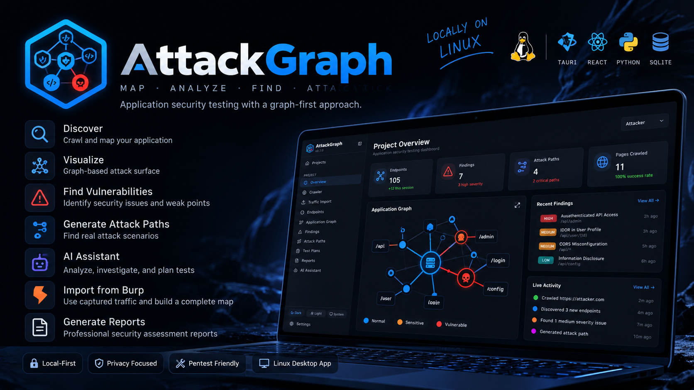
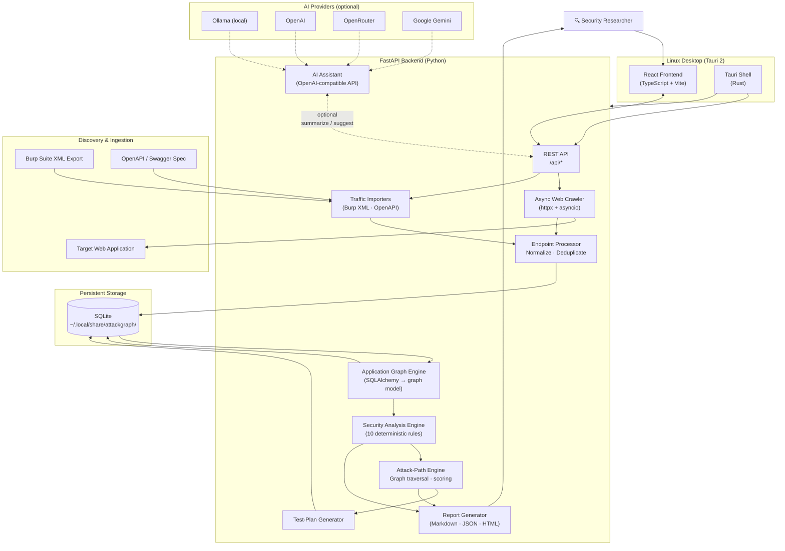
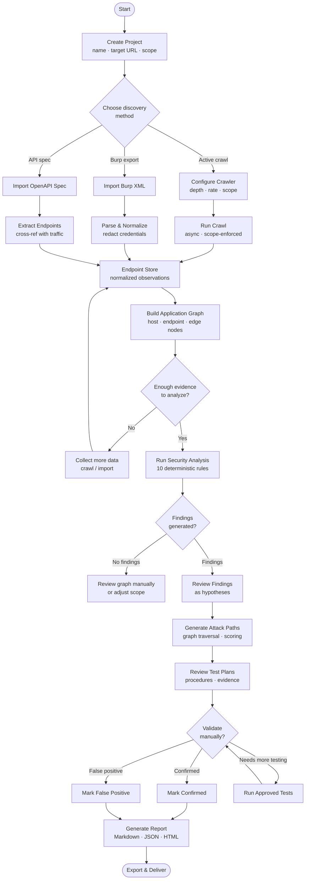
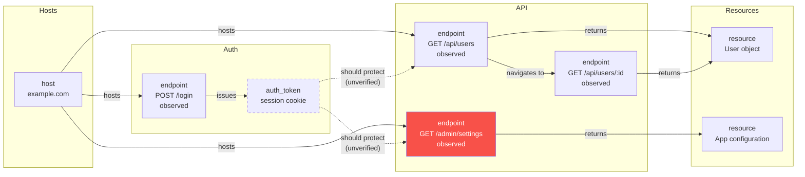

<div align="center">
  
</div>

<div align="center">

# AttackGraph

**Map · Analyze · Find**

A graph-first application security testing platform — crawl targets, import traffic, build an application graph, generate evidence-backed attack paths, and export professional security reports.

[](https://python.org)
[](https://fastapi.tiangolo.com)
[](https://react.dev)
[](https://tauri.app)
[](LICENSE)
[](#testing)

</div>

---

## Overview

AttackGraph is an open-source, **local-first** web application security platform for security researchers, penetration testers, and bug bounty hunters. It replaces scattered spreadsheets and notes with a structured workflow: discover endpoints, model the application as a directed graph, apply deterministic security analysis rules, and generate prioritized attack paths and test plans — all without sending your data to a cloud service.

**Key principles:**
- 🔒 **Local-first** — all data stays on your machine in a local SQLite database
- 🧠 **Graph-first** — the application model is a typed directed graph, not a flat list
- ⚠️ **Hypothesis-first** — findings are clearly labelled as unvalidated hypotheses until you confirm them
- 🤖 **AI-optional** — every core feature works without any AI provider; AI is an enhancement only

---

## Key Features

| Feature | Description |
|---------|-------------|
| **Active Crawler** | Async crawl with scope enforcement, robots.txt, form discovery, rate limiting |
| **Burp Suite Import** | Parse Burp XML exports with request/response analysis and redaction |
| **OpenAPI Import** | OpenAPI 2.0/3.0/3.1 — import endpoints and compare against observed traffic |
| **Application Graph** | Typed directed graph: hosts, endpoints, parameters, auth nodes, resource edges |
| **Security Analysis** | 10 deterministic rules generating evidence-backed security hypotheses |
| **Attack Paths** | Automated path discovery and priority scoring through the application graph |
| **Test Plans** | Structured procedures with preconditions, steps, evidence, and cleanup |
| **Reports** | Markdown, JSON, and HTML with clear confirmed-vs-hypothesis distinction |
| **AI Assistant** | Optional OpenAI-compatible integration (Ollama, OpenRouter, OpenAI, Gemini) |
| **Linux Desktop** | Native Tauri 2 desktop app with auto-started backend and XDG data storage |
| **Dark/Light/System** | Persistent theme with live switching |

---

## Architecture

The following diagram shows how AttackGraph components interact at runtime.



---

## How AttackGraph Works

### Step 1 — Project and Scope

Create a project for each target. Define the target URL, allowed hosts, and excluded paths. The crawler and analysis engine enforce scope at every step — no data is collected or stored outside your defined scope.

### Step 2 — Data Ingestion

AttackGraph supports three input methods:

| Method | How |
|--------|-----|
| **Active Crawl** | Configure depth, concurrency, rate limit, and robots.txt compliance. The async crawler follows links, discovers forms, extracts JavaScript-embedded URLs, and records every request and response. |
| **Burp Suite Import** | Export HTTP history as XML from Burp Suite and import. Requests are parsed, headers stripped of sensitive values, cookies redacted, and endpoints normalized. |
| **OpenAPI Import** | Provide an OpenAPI 2.0, 3.0, or 3.1 specification. Endpoints are extracted and cross-referenced against traffic already observed. |

### Step 3 — Endpoint Processing

Every discovered request is normalized (path parameters unified, query strings separated, duplicates merged), deduplicated against existing records, and stored as an `Endpoint` with associated `Observation` records. Observations retain the full method, URL, status code, and content type while stripping credential headers.

### Step 4 — Application Graph

Click **Build Graph** to generate a directed graph from stored observations:

- **Host nodes** — each in-scope hostname
- **Endpoint nodes** — each unique normalized URL + method pair, typed as `page`, `endpoint`, `form`, `parameter`, `redirect`, or `resource`
- **Edges** — observed navigation (page → page), form submission (form → endpoint), and inferred relationships
- Each node carries `evidence_source` (crawl / burp / openapi), `confidence`, and `observed` (boolean: was this directly seen or inferred?)

### Step 5 — Security Analysis

Click **Run Analysis** to apply 10 deterministic rules to the graph and stored observations:

| Rule | What it detects |
|------|----------------|
| Unauthenticated admin/settings access | Sensitive admin endpoints reachable without auth |
| Debug/diagnostic endpoints | `/debug`, `/info`, `/health` returning sensitive data |
| Potential IDOR | Object ID parameters without consistent auth patterns |
| Exposed API without auth | API endpoints returning 200 with no apparent auth |
| Undocumented endpoint | Endpoint discovered in traffic but absent from OpenAPI spec |
| CORS misconfiguration | Permissive Access-Control-Allow-Origin headers |
| Missing rate limiting | Authentication-related endpoints without 429 responses |
| Sensitive data in URL | Tokens, keys, or passwords in query parameters |
| Unauthenticated user enumeration | User-listing endpoints accessible without auth |
| Unprotected sensitive operations | Write/delete operations without clear auth enforcement |

All findings are created as **hypotheses** (`validation_status: hypothesis`) — they represent candidate issues, not confirmed vulnerabilities.

### Step 6 — Attack Paths and Test Plans

The attack-path engine traverses the application graph from entry points to sensitive operations, scores candidate paths by priority, and generates structured test plans with:
- Required test accounts and preconditions
- Step-by-step test procedure
- Expected secure behavior
- Potential insecure outcomes
- Evidence to capture
- Cleanup steps

You review each finding and test plan and update their status (`unvalidated → confirmed / false_positive / inconclusive`).

### Step 7 — Reports

Generate a security assessment report in three formats:

| Format | Content |
|--------|---------|
| **Markdown** | Full report with executive summary, endpoint inventory, findings, attack paths, test plans, and limitations disclaimer |
| **JSON** | Machine-readable structured report for integration with other tools |
| **HTML** | Self-contained, styled HTML document with severity badges, tables, and print styles |

All reports include a clear disclaimer separating confirmed findings from unvalidated hypotheses.

### Step 8 — AI Assistance (Optional)

If configured, the AI assistant can summarize the application graph and suggest security focus areas. It uses any OpenAI-compatible API — local Ollama models, OpenRouter, OpenAI, or Google Gemini.

The AI assistant:
- Receives redacted graph data (sensitive values stripped before transmission)
- Returns a natural language summary rendered as formatted Markdown
- Is clearly labelled as AI-generated output, not verified findings
- Is entirely optional — all analysis above runs without it

---

## End-to-End Workflow



---

## Application Graph Model

The graph below shows a conceptual example of how AttackGraph models an application. This is illustrative — real graphs are generated from actual observed traffic.



> **Legend:** Solid arrows = observed relationships · Dashed arrows = inferred/unverified · Red nodes = potential security findings

---

## Security Analysis Lifecycle

```mermaid
flowchart LR
    E["Collected Evidence\ncrawl · burp · openapi"] --> N
    N["Normalize Observations\nmethod · URL · status\nredact credentials"] --> M
    M["Update Application Graph\nhost · endpoint · edge nodes\nobserved vs inferred"] --> A
    A["Apply Analysis Rules\n10 deterministic rules\nevidence-based only"] --> H
    H["Generate Hypotheses\nvalidation_status: hypothesis\nnever auto-confirmed"] --> R
    R["Human Review\nmanual validation\napprove test plans"] --> F
    F["Document Findings\nconfirmed · false_positive\ninconclusive"] --> Rep
    Rep["Generate Report\nMarkdown · JSON · HTML\nhypothesis disclaimer"]

    style H fill:#d29922,color:#000
    style R fill:#3fb950,color:#000
    style F fill:#58a6ff,color:#000
```



---

## Screenshots

> Screenshots showing the dashboard, graph view, and findings panel are available in the `docs/assets/` directory and the [project banner](docs/assets/attackgraph-banner.png).

The application provides:
- **Project Overview** — endpoint count, finding severity distribution, crawl history, quick actions
- **Crawler** — live session monitoring with progress bars and cancellation
- **Endpoints** — filterable table with inline detail expansion and observation history
- **Application Graph** — interactive ReactFlow graph with node type filtering and rebuild
- **Findings** — expandable cards with severity badges, reproduction steps, and status management
- **Attack Paths** — chain visualization with confidence scores and recommended steps
- **Test Plans** — structured procedures with status tracking
- **Reports** — format tabs (Markdown / JSON / HTML) with preview and download
- **AI Assistant** — provider configuration (Ollama · OpenAI · Gemini · OpenRouter) and graph summary

---

## Installation

### Prerequisites

| Requirement | Version | Check |
|-------------|---------|-------|
| Python | 3.11+ | `python3 --version` |
| Node.js | 18+ | `node --version` |
| Rust | 1.75+ | `rustc --version` |
| webkit2gtk-4.1 | — | `pkg-config --exists webkit2gtk-4.1` |

**Arch Linux:**
```bash
sudo pacman -S python nodejs rust webkit2gtk-4.1 base-devel
```

**Ubuntu / Debian:**
```bash
sudo apt install python3 python3-pip nodejs npm rustup \
  libwebkit2gtk-4.1-dev libssl-dev libgtk-3-dev libayatana-appindicator3-dev librsvg2-dev
```

### Clone and Set Up

```bash
git clone https://github.com/0x5t4l1n/Attackgraph.git
cd Attackgraph

# Python backend
python3 -m venv .venv
source .venv/bin/activate
pip install -e "backend[dev]"

# Frontend
cd frontend
npm install
```

### Run in Development Mode

```bash
# Terminal 1 — backend
cd Attackgraph
source .venv/bin/activate
uvicorn backend.api.main:app --host 127.0.0.1 --port 8000 --reload

# Terminal 2 — frontend dev server
cd frontend
npm run dev

# Open http://localhost:5174
```

### Run as Linux Desktop App (Tauri)

```bash
cd frontend
cargo tauri dev
```

The Tauri shell automatically starts the FastAPI backend and opens a native window.

---

## Quick Start

```bash
# 1. Start AttackGraph
cd frontend && cargo tauri dev

# 2. Create a project
#    UI: click "New Project" → enter name and target URL → Create

# 3. Run a crawl (only on authorized targets)
#    UI: Crawler → configure depth/rate → Start Crawl

# 4. Build the graph
#    UI: Overview → Build Graph

# 5. Run analysis
#    UI: Overview → Run Analysis

# 6. Review findings
#    UI: Findings → expand each card → update status

# 7. Generate report
#    UI: Reports → select format → Generate Report → Download
```

> ⚠️ **Only use AttackGraph on systems you own or have explicit written authorization to test.**

---

## Production Build

```bash
# Build AppImage + .deb for Linux
cd frontend
cargo tauri build

# Artifacts:
# src-tauri/target/release/bundle/appimage/AttackGraph_0.1.0_amd64.AppImage
# src-tauri/target/release/bundle/deb/AttackGraph_0.1.0_amd64.deb
```

### Install from AppImage

```bash
chmod +x AttackGraph_0.1.0_amd64.AppImage
./AttackGraph_0.1.0_amd64.AppImage
```

### Install from .deb

```bash
sudo dpkg -i AttackGraph_0.1.0_amd64.deb
attackgraph
```

---

## Configuration

### AI Assistant (Optional)

Configure via **Settings → AI Assistant** in the UI. Supported providers:

| Provider | API Base | Key Required |
|----------|----------|-------------|
| Ollama (local) | `http://localhost:11434/v1` | No |
| OpenAI | `https://api.openai.com/v1` | Yes |
| Google Gemini | `https://generativelanguage.googleapis.com/v1beta/openai` | Yes |
| OpenRouter | `https://openrouter.ai/api/v1` | Yes |

Config is stored at `~/.local/share/attackgraph/ai_config.json`.

### Data Storage

All project data is stored at `~/.local/share/attackgraph/attackgraph.db` (XDG-compliant). Override with:

```bash
export ATTACKGRAPH_DATA_DIR=/path/to/data
```

### Crawler Defaults

| Setting | Default | Notes |
|---------|---------|-------|
| Max depth | 3 | Link-follow depth |
| Max pages | 500 | Hard stop |
| Concurrency | 5 | Parallel requests |
| Rate limit | 10 req/s | Per-host throttle |
| Robots.txt | Respected | Disable only on authorized targets |
| Private networks | Blocked | Enable explicitly for local targets |

---

## Development and Testing

### Backend Tests

```bash
cd /path/to/attackgraph
source .venv/bin/activate
python -m pytest backend/tests/ -v
# 88 tests covering: crawler, importer, graph, analysis, reporting, API
```

### Frontend Type Check and Build

```bash
cd frontend
npx tsc --noEmit   # type check
npm run build      # production build
```

### Tauri Rust Check

```bash
cd frontend/src-tauri
cargo check
```

### Project Structure

```
attackgraph/
├── backend/
│   ├── api/main.py          # FastAPI application + all routes
│   ├── crawler/             # Async web crawler (httpx + asyncio)
│   ├── importers/           # Burp XML and OpenAPI importers
│   ├── graph/               # Application graph construction
│   ├── security_rules/      # 10 deterministic analysis rules
│   ├── attack_paths/        # Attack-path traversal engine
│   ├── test_planner/        # Test-plan generator
│   ├── reporting/           # Markdown · JSON · HTML reporters
│   ├── ai_assistant/        # OpenAI-compatible AI integration
│   ├── storage/             # SQLAlchemy models + database setup
│   └── config.py            # Settings with XDG data dir support
├── frontend/
│   ├── src/
│   │   ├── pages/           # 13 page components
│   │   ├── components/      # Shared UI (layout · ui)
│   │   ├── contexts/        # ThemeContext
│   │   ├── services/api.ts  # API client
│   │   └── index.css        # Design system tokens
│   └── src-tauri/           # Tauri 2 Rust shell
├── docs/assets/             # README banner and screenshots
├── backend_server.py        # PyInstaller entry point
├── attackgraph_backend.spec # PyInstaller spec
├── install.sh               # Installer helper
└── CONTRIBUTING.md          # Contribution guidelines + AI policy
```

---

## Project Status

### Implemented ✅

- Active async web crawler with scope enforcement
- Burp Suite XML import with credential redaction
- OpenAPI 2.0 / 3.0 / 3.1 import
- Application graph construction from observations
- 10 deterministic security analysis rules
- Attack-path traversal and priority scoring
- Test-plan generation
- Markdown, JSON, and HTML report generation
- React 19 frontend with all 13 pages
- Light / Dark / System theme with persistence
- Linux desktop app (Tauri 2) with auto-started backend
- AppImage and .deb build targets
- Optional AI assistant (Ollama, OpenAI, Gemini, OpenRouter)
- XDG-compliant data storage

### Experimental / In Progress 🔄

- Frontend unit and integration tests
- Rate-limit detection rule (heuristic, low confidence)
- JavaScript endpoint extraction (basic, no AST parsing)

### Planned 📋

- Authentication replay and session token tracking
- Playwright-based dynamic crawling
- Nuclei template generation from findings
- Multi-user project sharing
- Plugin API for custom analysis rules

---

## Security and Responsible Use

AttackGraph is designed for **authorized security testing only**.

- Only use AttackGraph against systems you own or have explicit written permission to test
- The crawler respects `robots.txt` by default — disable only on authorized targets
- All data remains local — no telemetry, no cloud sync
- AI features transmit only redacted graph summaries — never raw requests, credentials, or full responses
- Findings are hypotheses until manually validated — never treat an automated finding as a confirmed vulnerability
- The application graph is a model based on observations — it does not automatically exploit vulnerabilities

See [SECURITY.md](SECURITY.md) for responsible disclosure guidelines.

---

## Contributing

Contributions are welcome. See [CONTRIBUTING.md](CONTRIBUTING.md) for full guidelines, including our **AI contribution disclosure policy** — every PR must declare whether it was human-authored, AI-assisted, or a collaboration, and which provider and model was used.

**Quick contribution checklist:**
1. Fork and create a feature branch from `main`
2. Add tests for new functionality
3. Run `python -m pytest backend/tests/ -v` (must pass)
4. Run `cd frontend && npm run build` (must succeed)
5. Fill in the PR template, including AI disclosure

---

## License

MIT License — see [LICENSE](LICENSE) for details.

---

<div align="center">

Built by [0x5t4l1n](https://github.com/0x5t4l1n) with AI assistance (Anthropic Claude Opus 4.6 via Claude Code)

**AttackGraph** — Map · Analyze · Find

</div>
